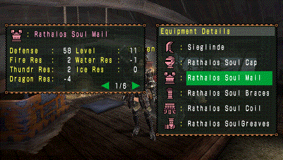

# MHFU Transmog

**Fashion hunting is here.** Change how your weapons and armor look in Monster Hunter Freedom Unite without touching their stats, solo and online.

## 👉 [Open the Transmog Generator](https://exceen.github.io/mhfu_transmog/)

The website generates CWCheat codes for PPSSPP and real PSP hardware. Everything is explained in its *Instructions* tab.



## Features

- **Weapon**: make a weapon look like another weapon of the same type
- **Armor (Single Slot)** and **Armor (Set)**: change the look of one piece or a whole set, including invisible pieces, opposite-gender models, Blademaster/Gunner variants and pigment on/off
- **Universal Invisible**: hide every piece of an armor slot, whatever is equipped
- **Multiplayer**: codes that let other players see your transmog (and you see theirs)
- **Real PSP** output format: splits long codes into parts of at most 30 lines (CWCheat limit)

Stats, skills, slots and decorations always stay those of the gear you actually have equipped.

## Multiplayer

Normally transmog only changes your own game: other players see your real gear. Add the **Multiplayer Armor Transmog** and/or **Multiplayer Weapon Transmog** codes from the website's *Multiplayer* tab, and every player who also runs them sees your transmog. Players without them simply see your real equipment; nothing breaks for them.

Tested on PPSSPP (two machines over an ad-hoc server) and on a real PSP.

**Optional: Multiplayer Marker.** Shows in the gathering hall who uses the Multiplayer codes: other players running them get a `°` in front of their name (name tags and player list). Your own name never changes, and only you see the marker. It isn't on the website; copy it from [`online/marker_codes.txt`](online/marker_codes.txt) (PPSSPP and Real PSP parts).

## Compatibility

Monster Hunter Freedom Unite (ULJM05500). Tested with [FUComplete](https://github.com/FUComplete/FUComplete) v1.4.0 only; other versions may work but are untested. For multiplayer, everyone in the room should use the same game version.

## How It Works

The game stores equipment data in static memory tables. Each armor/weapon entry contains a model ID that determines its 3D appearance. The generated codes overwrite these model IDs, so one piece of equipment looks like another while keeping its stats.

On its own this only affects your game, because other players look up your equipment in their own tables. The Multiplayer codes hook the game in two places: when your equipment is sent to other players, the sender stores the model numbers from your (patched) tables in spare bits of that data; when another player's hunter is drawn, the receiver uses those models instead of its own lookup. Unmodified games ignore the extra bits.

See [FINDINGS.md](FINDINGS.md) for the full reverse-engineering documentation: memory table layouts, address calculations, network data and known pitfalls.

## Development

The website (`docs/`) reads two committed files and the weapon and armor slot icons (`images/w_*.png`, `images/a_*.png`), which the GitHub Pages workflow copies into `docs/` on deploy. To test locally, copy them yourself and start a web server:

```bash
cp transmog_data.json online_codes.json docs/
mkdir -p docs/images && cp images/w_*.png images/a_*.png docs/images/
cd docs && python3 -m http.server 8000
```

**Multiplayer codes** (`online_codes.json`) are assembled from `online/armor.asm` and `online/weapon.asm`, the optional marker (`online/marker_codes.txt`) from `online/marker.asm`. Only needed after changing the assembly:

```bash
python3 online/build.py   # needs armips on PATH
```

**Equipment data** (`transmog_data.json`). Only needed if FUComplete changes its equipment tables:

1. Launch the game in PPSSPP **without** any transmog cheats enabled and create a save state (slot 0).
2. Run `pip install -r requirements.txt` and `python3 build_data.py` (or `python3 build_data.py <slot>` for another save state slot). This scrapes equipment names from the [FUComplete docs](https://fucomplete.github.io/files_doc/player/player_asset.html) and reads the armor/weapon tables from the save state.
